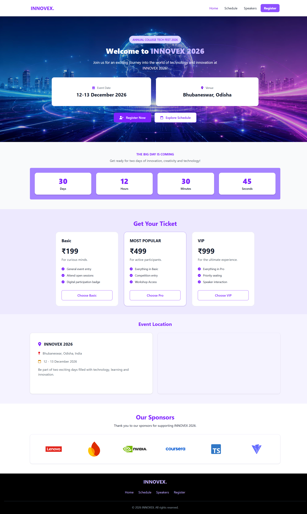
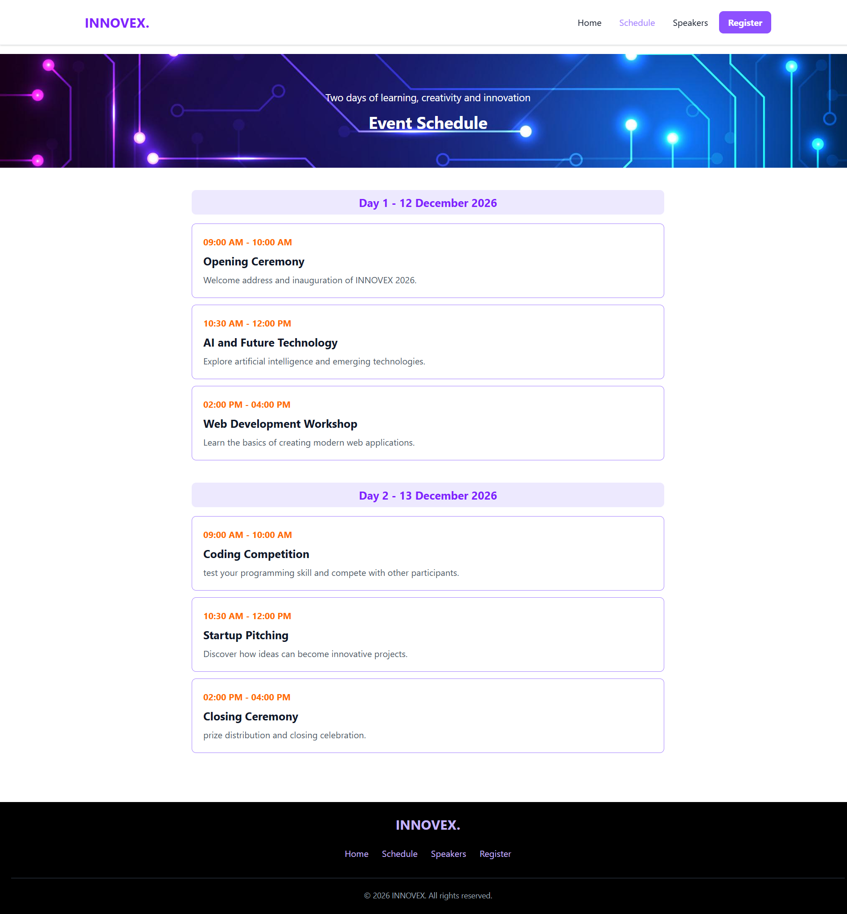
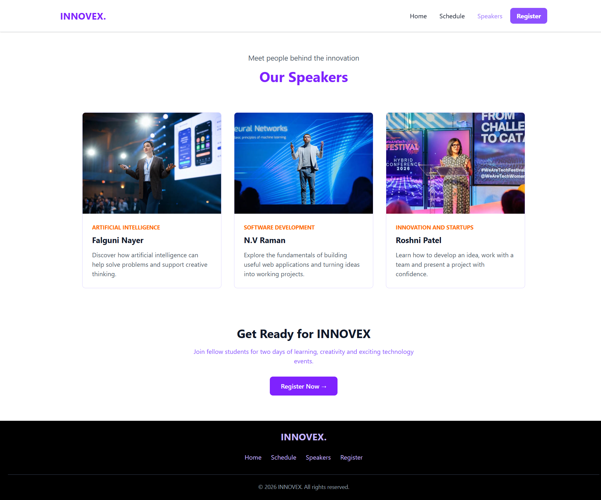
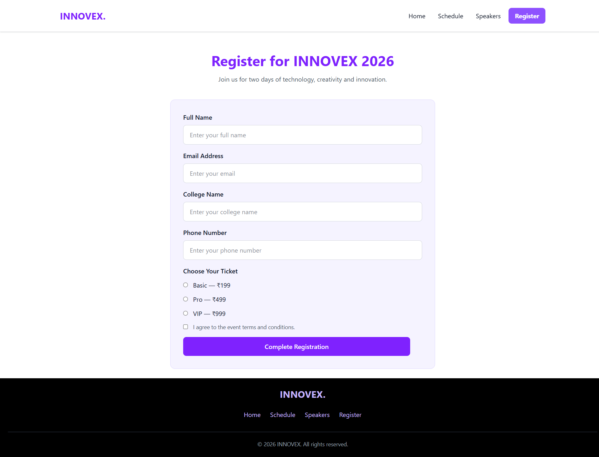

# INNOVEX 2026

A responsive college tech fest website built using HTML and Tailwind CSS. It features event information, schedules, speakers, and participant registration.

## About the Project

This website is designed for a two-day college technology festival happening on 12–13 December 2026 in Bhubaneswar, Odisha.

## Features

- Responsive layout for different screen sizes.
- Dark mode styling.
- Navigation between all four pages.
- Ticket information with different pricing options.
- Registration form with HTML validation.
- Google Maps embedded to show the event location.
- Speaker profiles with images.

## Technologies Used

- HTML5
- Tailwind CSS v4
- Font Awesome
- Google Maps Embed

## Screenshots

### Home Page

### Schedule Page

### Speakers Page

### Registration Page

## Live Deployment Link

[View Live Website](https://innovex-tech-fest.vercel.app/)

## GitHub URL

[View GitHub Repository](https://github.com/beherakiran/innovex-tech-fest)